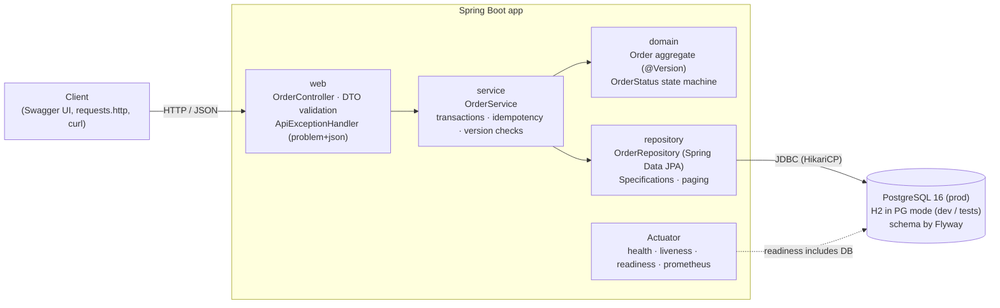
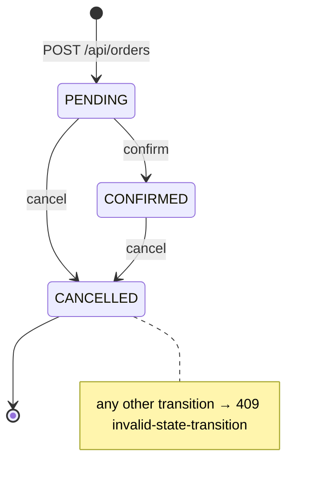

# Order Management Service

A REST microservice to create, retrieve, list, confirm and cancel orders, built with **Java 21, Spring Boot 3.5, Spring Data JPA, Flyway and PostgreSQL**. It focuses on the parts that are easy to get wrong in a real service:

- **Request validation:** Bean Validation on every input, with field-level errors.
- **Enforced lifecycle rules:** `PENDING → CONFIRMED → CANCELLED` (or `PENDING → CANCELLED`), enforced inside the `Order` entity.
- **Transactional JPA persistence:** explicit transaction boundaries; the schema comes from Flyway, and Hibernate only validates it.
- **Optimistic locking:** a JPA `@Version` check, plus `ETag`/`If-Match` preconditions for clients.
- **Idempotent creates:** an `Idempotency-Key` header makes retries safe, even when they run concurrently.
- **Consistent errors:** every error is `application/problem+json` (RFC 9457, formerly RFC 7807).
- **Operations:** Actuator health with liveness and readiness probes, Prometheus metrics, OpenAPI with Swagger UI.

It's an educational starter: there is **no authentication**. It runs with zero setup on in-memory H2 (`dev` profile) or on PostgreSQL (`prod` profile).

## Architecture





## Endpoints

| Method | Path | Purpose | Success | Errors |
|---|---|---|---|---|
| `POST` | `/api/orders` | Create an order. Optional `Idempotency-Key` header. The server computes the totals. | `201` + `Location`, `ETag`; `200` on an idempotent replay (`Idempotent-Replayed: true`) | `400` validation, `422` key reused with a different body |
| `GET` | `/api/orders/{id}` | Get one order; `ETag` carries its version | `200` | `404` |
| `GET` | `/api/orders` | List, newest first. `status`, `customerId`, `page`, `size` (default 20, max 100), `sort` (allow-listed) | `200` page envelope | `400` bad filter or sort |
| `POST` | `/api/orders/{id}/confirm` | `PENDING → CONFIRMED`. Optional `If-Match: "<version>"` | `200` | `404`, `409` illegal transition or concurrent modification, `412` stale `If-Match` |
| `POST` | `/api/orders/{id}/cancel` | `PENDING`/`CONFIRMED → CANCELLED`; optional body `{"reason": "..."}` and `If-Match` | `200` | `404`, `409`, `412` |
| `GET` | `/actuator/health`, `/actuator/health/liveness`, `/actuator/health/readiness` | Health probes; readiness includes the database | `200` | `503` when down |
| `GET` | `/actuator/prometheus` | Metrics, including `orders_placed_total`, `orders_confirmed_total`, `orders_cancelled_total`, `orders_idempotent_replays_total` | `200` | |
| `GET` | `/swagger-ui/index.html`, `/v3/api-docs` | Interactive docs and the OpenAPI document (`/` redirects to Swagger UI) | `200` | |

Example error (illegal transition):

```json
{
  "type": "/problems/invalid-state-transition",
  "title": "Invalid order state transition",
  "status": 409,
  "detail": "Order 6 cannot move from CONFIRMED to CONFIRMED",
  "instance": "/api/orders/6/confirm",
  "orderId": 6,
  "currentStatus": "CONFIRMED",
  "targetStatus": "CONFIRMED"
}
```

[`requests.http`](requests.http) walks through the whole lifecycle and every error case (VS Code REST Client). [`scripts/smoke.sh`](scripts/smoke.sh) runs the same flow with curl and checks each status code.

## Run locally

### With Docker (PostgreSQL, the `prod` profile)

Needs only Docker.

```bash
docker compose up --build
```

The API is at http://localhost:8080 (redirects to Swagger UI) and Postgres is on host port 5433. On startup Flyway applies `V1__create_orders.sql` and 5 demo orders are seeded. Override values in a local `.env` (copy [`.env.example`](.env.example)). Then, from another terminal:

```bash
scripts/smoke.sh
```

Stop with `docker compose down` (add `-v` to delete the database volume).

### Without Docker (in-memory H2, the `dev` profile)

Needs JDK 21. The Maven wrapper downloads Maven itself.

```bash
./mvnw spring-boot:run
```

H2 runs in PostgreSQL mode with the same Flyway migration; the H2 console is at http://localhost:8080/h2-console (JDBC URL `jdbc:h2:mem:orders`, user `sa`, no password). Data is lost on restart.

To run against your own Postgres instead: `SPRING_PROFILES_ACTIVE=prod DB_HOST=... DB_USER=... DB_PASSWORD=... ./mvnw spring-boot:run`.

## Tests

```bash
./mvnw verify
```

| Suite | Kind | What it covers |
|---|---|---|
| `OrderTest` | Plain JUnit | State machine, totals, every legal and illegal transition |
| `CreateOrderCommandTest` | Plain JUnit | Idempotency fingerprint is stable (`10.5` equals `10.50`) |
| `OrderControllerTest` | `@WebMvcTest` | Status codes, headers (`Location`, `ETag`, `If-Match`), validation and problem+json bodies |
| `OrderRepositoryTest` | `@DataJpaTest` on the Flyway schema | Persistence, version increments, filters with paging, unique idempotency key |
| `OrderApiH2Test` | `@SpringBootTest`, real HTTP, H2 | Full lifecycle; **two parallel confirms give exactly one 200 and one 409**; 8 parallel retries with one key create one order; health probes, Prometheus, Swagger UI |
| `OrderApiPostgresIT` | Testcontainers, **PostgreSQL 16**, `prod` profile | The same end-to-end scenarios plus a Flyway history check, on real Postgres |

Last local run (2026-11-05, see [`CHECKPOINT.md`](CHECKPOINT.md)): 48 surefire tests and 4 failsafe tests against PostgreSQL 16, all passing.

The concurrency test is deterministic: a test `Clock` acts as a barrier, so both confirms have loaded version 0 before either one flushes. Surefire runs `*Test`, then Failsafe runs `*IT`. The IT needs Docker and is skipped, not failed, when Docker isn't available.

No JDK? Run the build in a container (the named volume caches dependencies between runs; mounting the Docker socket lets Testcontainers start Postgres):

```bash
docker run --rm -v "$PWD":/workspace -w /workspace -v orders-m2:/root/.m2 \
  -v /var/run/docker.sock:/var/run/docker.sock -e TESTCONTAINERS_HOST_OVERRIDE=host.docker.internal \
  maven:3-eclipse-temurin-21 ./mvnw -B -ntp verify
```

In Git Bash on Windows, prefix that command with `MSYS_NO_PATHCONV=1` so the container paths aren't rewritten.

CI ([`.github/workflows/ci.yml`](.github/workflows/ci.yml)) runs `./mvnw verify` on JDK 21 (including the Testcontainers tests), builds the Docker image and runs a gitleaks secret scan over the full git history.

## Deploy (Render)

[`render.yaml`](render.yaml) is a Render Blueprint: a Docker web service plus a managed PostgreSQL 16 database. The database credentials are injected as environment variables from the database, so no secret is stored in the repo. The health check path is `/actuator/health/readiness`, so traffic only arrives after Flyway has migrated and the database is reachable.

1. Push this repo to GitHub.
2. In Render: **New → Blueprint**, choose the repo, and apply. Render creates `orders-db` and `order-management-service`.
3. When the deploy is live, open `https://<service>.onrender.com` (it redirects to Swagger UI) or run `scripts/smoke.sh https://<service>.onrender.com`.

Free instances sleep when idle, so the first request after a pause takes a while to wake the service.

## Configuration

Every setting is an environment variable; [`.env.example`](.env.example) lists them all with defaults. The main ones:

| Variable | Default | Meaning |
|---|---|---|
| `SPRING_PROFILES_ACTIVE` | `dev` | `dev` = H2, `prod` = PostgreSQL |
| `PORT` | `8080` | HTTP port (Render sets it) |
| `DB_URL` or `DB_HOST` / `DB_PORT` / `DB_NAME` | `localhost:5432/orders` | PostgreSQL location (`prod`) |
| `DB_USER` / `DB_PASSWORD` | `orders` / empty | PostgreSQL credentials (`prod`) |
| `DB_POOL_MAX_SIZE` | `10` | HikariCP pool size |
| `SEED_DEMO_DATA` | `true` in `dev`, `false` in `prod` | Insert 5 demo orders if the table is empty |
| `HEALTH_SHOW_DETAILS` | `never` | Show component details on `/actuator/health` |

## Project layout

```
src/main/java/com/arshverma/orders/
  domain/       Order (aggregate root, @Version), OrderLine, OrderStatus, domain exceptions
  service/      OrderService (transactions, idempotency, version checks), commands
  repository/   OrderRepository (Spring Data JPA + Specifications)
  web/          OrderController, DTOs, ApiExceptionHandler, PageResponse
  config/       Clock, OpenAPI info, DemoDataSeeder
src/main/resources/
  application.yml, application-dev.yml, application-prod.yml
  db/migration/V1__create_orders.sql
```

## License

MIT
